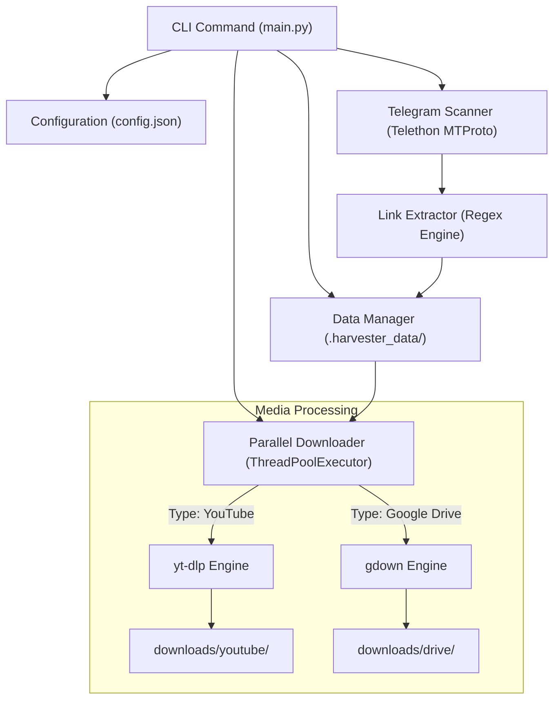

# 🔗 Telegram Link Harvester (`Telegram_yt-`)

[](https://www.python.org/)
[](https://github.com/LonamiWebs/Telethon)
[](https://github.com/yt-dlp/yt-dlp)
[](https://github.com/wkentaro/gdown)
[](#-license)

**Telegram Link Harvester** is a high-speed CLI tool built to automatically crawl Telegram channels and groups, detect embedded **YouTube** and **Google Drive** links with full conversational context, and concurrently download the media with multi-threaded worker pools and real-time progress visualization.

---

## 📑 Table of Contents

- [Overview & Highlights](#-overview--highlights)
- [Key Features](#-key-features)
- [Architecture & Workflow](#-architecture--workflow)
- [Prerequisites](#-prerequisites)
- [Installation & Setup](#-installation--setup)
- [Configuration Guide](#-configuration-guide)
- [Command Reference & Usage](#-command-reference--usage)
  - [1. Discover Channels (`list-channels`)](#1-discover-channels-list-channels)
  - [2. Scan Messages for Links (`scan`)](#2-scan-messages-for-links-scan)
  - [3. Inspect Harvested Links (`list`)](#3-inspect-harvested-links-list)
  - [4. Download Media in Parallel (`download`)](#4-download-media-in-parallel-download)
  - [5. View Aggregated Status (`status`)](#5-view-aggregated-status-status)
- [Project & Data Structure](#-project--data-structure)
- [Performance & Worker Tuning](#-performance--worker-tuning)
- [Troubleshooting Guide](#-troubleshooting-guide)
- [Security & Privacy](#-security--privacy)
- [Contributing & Support](#-contributing--support)
- [License & Legal Disclaimer](#-license--legal-disclaimer)

---

## 💡 Overview & Highlights

Archiving shared educational resources, conference videos, and cloud drives from active Telegram communities is typically tedious and rate-limit prone. **Telegram Link Harvester** automates this end-to-end:
1. Connects to your Telegram account using MTProto through **Telethon**.
2. Scans messages across public handles or private IDs using regex pattern matchers for YouTube (including Shorts & Live streams) and Google Drive (files & folders).
3. Organizes metadata into channel-isolated JSON stores under `.harvester_data/channels/`.
4. Executes multi-worker parallel batch downloads via `yt-dlp` and `gdown` with terminal progress tracking (`tqdm`).

---

## ✨ Key Features

- **🚀 Concurrent ThreadPool Downloads**: Download multiple media streams simultaneously (default 4 workers, up to 3–5× faster than sequential downloading).
- **📊 Interactive Progress Bars**: Granular per-file speed and overall queue completion tracked via `tqdm`.
- **🔍 Context-Aware Extraction**: Preserves original post captions, timestamps, message IDs, and sender information alongside URLs.
- **🎯 Multi-Platform Engine**:
  - **YouTube**: Downloads high-definition video/audio via `yt-dlp`.
  - **Google Drive**: Downloads documents, archives, and media via `gdown`.
- **💾 Isolated Data Layer**: Stores channel data separately in `.harvester_data/channels/<channel_id>.json` to prevent data collisions.
- **🔄 Fault Recovery & Retries**: Automatically logs failed URLs and re-queues them during subsequent runs without re-downloading completed files.
- **🛡️ Rate-Limit Guards**: Configurable request spacing to prevent Telegram API FloodWait or platform IP bans.

---

## 🏗️ Architecture & Workflow



---

## 📋 Prerequisites

- **Python**: Version **3.10** or higher.
- **Telegram Account**: Active phone number.
- **Telegram API Credentials**: `api_id` and `api_hash` obtained from [my.telegram.org](https://my.telegram.org).
- **FFmpeg** *(Optional)*: Recommended for `yt-dlp` to merge highest-quality video and audio streams into MP4 format.

---

## 🚀 Installation & Setup

1. **Clone the repository**:
   ```bash
   git clone https://github.com/ShihabulSakib/Telegram_yt-.git
   cd Telegram_yt-
   ```

2. **Set up a virtual environment**:
   ```bash
   python3 -m venv venv
   source venv/bin/activate
   # On Windows: venv\Scripts\activate
   ```

3. **Install required dependencies**:
   ```bash
   pip install --upgrade pip
   pip install telethon yt-dlp gdown tqdm
   ```

4. **Prepare `config.json`**:
   Create a `config.json` file in the root directory:
   ```json
   {
     "api_id": "YOUR_API_ID",
     "api_hash": "YOUR_API_HASH",
     "phone": "+1234567890"
   }
   ```

---

## ⚙️ Configuration Guide

The `config.json` file stores credentials required to authenticate with the Telegram MTProto gateway:

| Field | Type | Description |
|---|---|---|
| `api_id` | `string` / `int` | Application ID from [my.telegram.org](https://my.telegram.org). |
| `api_hash` | `string` | Secret application hash key. |
| `phone` | `string` | Phone number formatted in international standard E.164 (e.g. `+88017...`). |

> [!CAUTION]
> Never commit `config.json` or your `.session` files to public version control repositories!

---

## 📖 Command Reference & Usage

Execute all tasks through `main.py`:

```bash
python main.py <command> [arguments] [options]
```

### 1. Discover Channels (`list-channels`)
Queries dialogs and groups connected to your account, outputting their titles, numeric IDs, and usernames. This also saves the list to `.harvester_data/channel_info.json`.
```bash
python main.py list-channels
```

### 2. Scan Messages for Links (`scan`)
Crawls messages in a specified channel or group and extracts YouTube and Google Drive URLs:
```bash
# Scan a public channel by username
python main.py scan @educationalchannel

# Scan a private channel by its numeric ID
python main.py scan -1001234567890

# Scan only the most recent 200 messages
python main.py scan @educationalchannel --limit 200
```

### 3. Inspect Harvested Links (`list`)
Displays collected links across all scanned channels, with indicators for download status:
```bash
# List all links from all channels
python main.py list

# Filter entries by keywords found in captions
python main.py list --filter "lecture"

# Filter by subject
python main.py list --filter "python"
```

**Status Indicators:**
- `[⏳]` **Pending**: Ready for download.
- `[✓]` **Completed**: Successfully saved to disk.
- `[✗]` **Failed**: Download error encountered; eligible for auto-retry.

### 4. Download Media in Parallel (`download`)
Launches the concurrent download queue:
```bash
# Download all pending links across all channels (default: 4 workers)
python main.py download --all

# Set custom worker concurrency
python main.py download --all --workers 5

# Download only YouTube videos
python main.py download --all --type youtube --workers 4

# Download only Google Drive documents
python main.py download --all --type drive --workers 3

# Filter specific content to download
python main.py download --filter "machine learning" --workers 4
```

### 5. View Aggregated Status (`status`)
Outputs high-level summary analytics of your harvest:
```bash
python main.py status
```

**Sample Output:**
```text
==================================================
TELEGRAM LINK HARVESTER - STATUS
==================================================
Total Links (all channels): 150
  ⏳ Pending/Failed: 12
  ✓ Completed: 138

By Type:
  YouTube: 95
  Google Drive: 55
==================================================
```

---

## 📂 Project & Data Structure

```text
Telegram_yt-/
├── main.py                     # Unified CLI tool containing all engine classes
├── config.json                 # User credentials (ignored by git)
├── .gitignore                  # Git ignore rules for sessions and data
├── README.md                   # Project documentation
│
├── downloads/                  # Output directory for downloaded files
│   ├── youtube/                # YouTube videos saved here
│   └── drive/                  # Google Drive downloads saved here
│
└── .harvester_data/            # Isolated persistent storage
    ├── channel_info.json       # Cached output from list-channels
    └── channels/               # Channel-specific databases
        ├── @educhannel.json
        └── -1001234567890.json
```

---

## ⚡ Performance & Worker Tuning

| Workers | Network Bandwidth | System Load | Recommended Scenario |
|:---:|:---:|:---:|---|
| **1 – 2** | < 10 Mbps | Minimal | Slow connections, strict rate-limit caution |
| **3 – 4** | 10 – 50 Mbps | Moderate | ⭐ **Default & Recommended** for general usage |
| **5 – 6** | 50+ Mbps | High | High-speed networks with large batches |
| **7+** | High-speed Fiber | Very High | ⚠️ High risk of IP rate limiting from platforms |

---

## 🛠️ Troubleshooting Guide

### 1. `config.json not found`
Ensure `config.json` exists in the repository root directory with valid `api_id`, `api_hash`, and `phone` attributes.

### 2. `telethon` or `yt_dlp` import errors
Verify that you have activated your virtual environment and installed the dependencies:
```bash
pip install telethon yt-dlp gdown tqdm
```

### 3. `Cannot find any entity corresponding to ...`
- Confirm your account is joined to the target group or channel.
- Run `python main.py list-channels` to verify the exact handle or `-100...` numerical identifier.

### 4. `SessionPasswordNeededError`
Your account is protected by 2FA. When prompted, type your two-step verification password into the terminal. Telethon will securely cache the session string in a local `.session` file.

### 5. Google Drive "Permission denied" or YouTube "Private video"
Certain media links require direct account permissions:
- For Google Drive files, ensure sharing is set to "Anyone with the link".
- For private YouTube videos, verify that the link is accessible in a public browser.

---

## 🔒 Security & Privacy

- **Session Files**: Files matching `*.session` contain authorized Telegram tokens. Store them securely.
- **Git Hygiene**: Always ensure `.harvester_data/`, `downloads/`, `config.json`, and `*.session` remain excluded in your `.gitignore`.
- **Credential Safety**: Never publish API hashes or session tokens on open public platforms.

---

## 🤝 Contributing & Support

Contributions, pull requests, and suggestions are welcome!
- Check existing issues before opening new ones.
- When submitting improvements to download parsers or regex filters, verify against edge-case URLs.

---

## 📝 License & Legal Disclaimer

This utility is provided under the **MIT License**.

> [!IMPORTANT]
> This tool is strictly intended for personal archiving, backup, and educational use. Always respect intellectual property rights and adhere to Telegram, YouTube, and Google Drive Terms of Service.

---

<div align="center">
  <sub>Made with ❤️ for Telegram power users & researchers.</sub>
</div>
